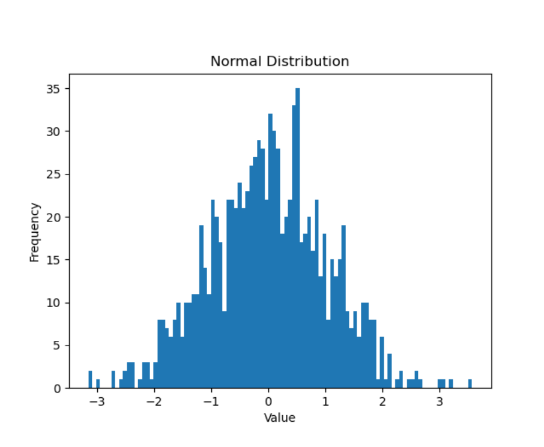
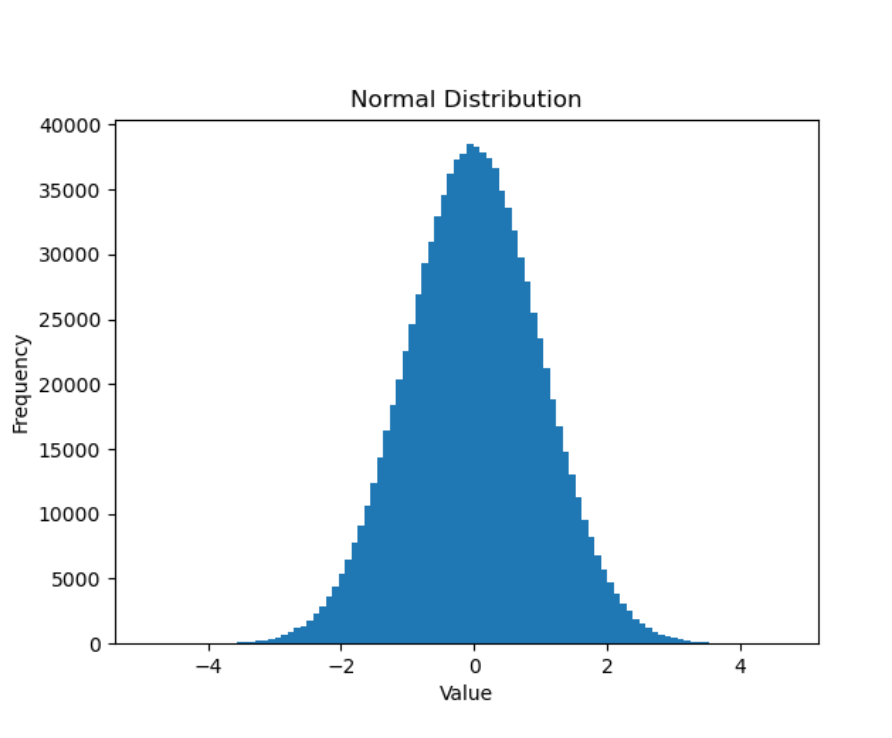

# 深度学习基础第一周学习 Blog：PyTorch 入门与螺旋数据分类

**学习内容：** PyTorch 张量基础、神经网络分类实验及六个理论问题的思考。  
**实验依据：** OUC AI Lab《第 1 章：深度学习基础》。  
**实验环境：** Python、PyTorch、Anaconda、PyCharm、Google Colab。

本报告根据第一周原始实验记录整理。图片仅保留随机数分布直方图；代码运行截图、张量输出截图、螺旋数据散点图和分类边界截图均改为代码、文字或结果说明。

---

# 第一部分：代码练习

## 一、4.1 PyTorch 基础练习

本节在 PyCharm 中运行 PyTorch 基础代码，观察 Tensor 的创建、维度、索引、计算和可视化。课程建议在 Colab 运行；本次 4.1 实验记录显示使用本地 Anaconda/PyCharm 环境。

### 1. 张量创建与维度

Tensor（张量）是 PyTorch 中最基础的数据结构，也是神经网络存储数据和进行计算的基础。

**实验代码：**

```python
import torch

x = torch.tensor(666)
v = torch.tensor([1, 2, 3, 4, 5, 6])
a = torch.ones(2, 3, 4)
b = torch.rand(5, 3)
```

**知识点：**

- 标量（Scalar）：零维张量，只包含一个数值。
- 向量（Vector）：一维张量，可以存储一组有序数据。
- 矩阵（Matrix）：二维张量。
- 高维张量：具有三个或更多维度的数据结构。
- `torch.tensor()`：根据给定数据创建张量。
- `torch.ones()`：生成元素全部为 1 的张量。
- `torch.rand()`：生成 `[0, 1)` 区间内的均匀随机数。
- `torch.empty()`：分配未初始化内存，因此其中的数值不能直接视为有效结果。

### 2. 张量索引、转置和矩阵乘法

**实验代码：**

```python
m = torch.tensor(
    [[2, 5, 3, 7],
     [4, 2, 1, 9]],
    dtype=torch.float32
)

v = torch.arange(1, 5, dtype=torch.float32)

print(m.size(), m.numel())
print(m[:, 1], m[0, :])
print(m @ v)
print(m.t())
```

**知识点：**

1. `m.size()`：获取张量形状。本例为 `(2, 4)`，表示 2 行、4 列。
2. `m.numel()`：获取张量元素总数。本例共有 8 个元素。
3. `m[:, 1]`：选取第二列；冒号 `:` 表示该维度全部选取。
4. `m[0, :]`：选取第一行。
5. `m @ v`：执行矩阵与向量乘法。本例结果为 `[49., 47.]`，分别是矩阵两行与向量的点积。
6. `m.t()`：执行矩阵转置，将形状从 `(2, 4)` 变为 `(4, 2)`。

需要注意，矩阵乘法两侧的形状必须满足乘法规则，数据类型也需要兼容。

**关键输出整理：**

```text
矩阵形状：        (2, 4)
元素总数：        8
矩阵乘向量结果：  [49., 47.]
转置后形状：      (4, 2)
```

### 3. 张量拼接与随机分布

#### 3.1 张量拼接

**实验代码：**

```python
a = torch.tensor([[1., 2., 3., 4.]])
b = torch.tensor([[5., 6., 7., 8.]])

print(torch.cat((a, b), 0))  # 2×4
print(torch.cat((a, b), 1))  # 1×8
```

`torch.cat()` 用于沿指定维度拼接张量：

- `dim=0`：沿第 0 维拼接，本例得到形状为 `2×4` 的张量。
- `dim=1`：沿第 1 维拼接，本例得到形状为 `1×8` 的张量。

拼接时，除拼接维度外，其他维度的大小必须一致。

#### 3.2 随机数分布可视化

**实验代码：**

```python
from matplotlib import pyplot as plt

plt.hist(torch.randn(1000).numpy(), 100)
plt.show()
```

`torch.randn()` 生成服从标准正态分布的随机数。实验记录对比了 1000 个和 1000000 个随机数的直方图。

如果要用同样的方法绘制 1000000 个随机数，可以将样本数量改为 `1_000_000`：

```python
data = torch.randn(1_000_000)
plt.hist(data.numpy(), 100)
plt.show()
```

**图表 1：1000 个随机数的直方图**



**图表 2：1000000 个随机数的直方图**



**结果分析：**

对比两张直方图可以观察到，样本数量从 1000 增加到 1000000 后，分布轮廓更加平滑，也更接近钟形。这是样本量增大后统计分布更稳定的直观体现，并不意味着每次随机抽样都会得到完全相同的结果。

### 4.1 实验个人理解

4.1 最大的收获是区分张量形状、数据类型和运算方式。例如，`+` 是逐元素加法，`@` 是矩阵乘法；`arange` 的终点不包含在内。这些细节是后续神经网络开发和调试的基础。

---

## 二、4.2 螺旋数据分类

本节在 Google Colab 中完成，目标是比较不带激活函数的线性网络和加入 ReLU 的非线性网络在三类螺旋数据上的表现。

### 1. 准备环境与生成数据

实验首先下载 `plot_lib.py`，导入 `torch`、`math` 和绘图函数，配置 GPU/CPU 与随机种子，然后生成三类螺旋数据。

**关键代码：**

```python
N, D, C, H = 1000, 2, 3, 100

X = torch.zeros(N * C, D).to(device)
Y = torch.zeros(N * C, dtype=torch.long).to(device)

# 依次为三类样本计算半径、角度及标签
```

**参数说明：**

| 参数 | 数值 | 含义 |
|---|---:|---|
| `N` | 1000 | 每类样本数量 |
| `D` | 2 | 每个样本的特征维度 |
| `C` | 3 | 分类类别数量 |
| `H` | 100 | 隐藏层神经元数量 |

**数据集规模与实际输出：**

- 每类 1000 个样本，共 3 类，总样本数为 3000。
- 每个样本包含二维坐标。
- 标签为 `0`、`1`、`2`。

```text
X: torch.Size([3000, 2])
Y: torch.Size([3000])
```

三类样本相互缠绕，难以使用简单直线分隔，因此适合用于观察非线性模型的分类能力。原始螺旋数据分布图和张量输出截图不作为图片插入，相关信息在此通过数据规模、张量形状和文字说明呈现。

### 2. 训练不含激活函数的线性模型

**模型与训练配置：**

```python
model = nn.Sequential(
    nn.Linear(D, H),
    nn.Linear(H, C)
)

criterion = nn.CrossEntropyLoss()

optimizer = torch.optim.SGD(
    model.parameters(),
    lr=1e-3,
    weight_decay=1e-5
)
```

模型包含两个全连接层：

- 第一层 `nn.Linear(D, H)`：输入维度为 2，输出维度为 100。
- 第二层 `nn.Linear(H, C)`：输入维度为 100，输出维度为 3。

损失函数使用 `CrossEntropyLoss()`，优化器使用 SGD，学习率为 `1e-3`，权重衰减为 `1e-5`。

训练共进行 1000 轮，每轮执行前向传播、计算交叉熵损失、清零梯度、反向传播和参数更新。

**结果分析：**

虽然模型包含两个 `Linear` 层，但中间没有非线性激活函数，两个线性变换组合后仍可等效为一次仿射变换，因此难以拟合弯曲的螺旋分类边界。

课程网页参考准确率约为 50%。由于原始实验截图没有显示本次线性模型的最终准确率，因此这里不把课程参考值写成本人的实测结果。

### 3. 加入 ReLU 并重新训练

**模型与优化器代码：**

```python
model = nn.Sequential(
    nn.Linear(D, H),
    nn.ReLU(),
    nn.Linear(H, C)
)

optimizer = torch.optim.Adam(
    model.parameters(),
    lr=1e-3,
    weight_decay=1e-5
)
```

与线性模型相比，这次在两个全连接层之间加入了 ReLU 激活函数。ReLU 的计算方式为：

```python
f(x) = max(0, x)
```

它将负数变为 0，正数保持不变。加入 ReLU 后，网络可以学习非线性决策边界，从而更好地拟合复杂的螺旋数据。

本次实验同时将优化器从 SGD 改为 Adam。Adam 使用梯度的一阶矩和二阶矩估计，自适应调整参数更新步长。

**实际训练结果：**

| 指标 | 实际结果 |
|---|---:|
| 训练轮数 | 1000 轮（日志记录至第 999 轮） |
| Loss | 0.178407 |
| Accuracy | 0.949 |
| 训练集准确率 | 94.9% |

**关键训练输出：**

```text
[EPOCH]: 999
[LOSS]: 0.178407
[ACCURACY]: 0.949
```

**结果分析：**

与线性模型较简单的分类区域相比，加入 ReLU 后，模型能够学习非线性决策边界，更好地贴合三类螺旋数据。

需要注意，本次对比同时改变了激活函数和优化器，因此不能仅凭这次实验就把全部性能提升归因于 ReLU。另外，94.9% 是训练集准确率，不代表模型在独立测试集上的泛化能力。

### 4.2 实验对比与个人理解

| 对比项目 | 线性模型 | 加入 ReLU 的模型 |
|---|---|---|
| 网络结构 | Linear → Linear | Linear → ReLU → Linear |
| 激活函数 | 无 | ReLU |
| 损失函数 | CrossEntropyLoss | CrossEntropyLoss |
| 优化器 | SGD | Adam |
| 学习率 | 0.001 | 0.001 |
| 权重衰减 | 0.00001 | 0.00001 |
| 训练轮数 | 1000 | 1000 |
| 准确率记录 | 原截图未显示本次实测值；课程参考约 50% | 训练集准确率 94.9% |

本次实验直观展示了非线性表达能力的重要性。不过，由于激活函数和优化器同时发生变化，后续如果要严谨比较 ReLU 的作用，应在相同优化器、相同随机种子和相同训练条件下进行对照实验，并增加独立验证集。

---

# 第二部分：问题总结与个人思考

## 1. AlexNet 有哪些特点？为什么比 LeNet 表现更好？

AlexNet 使用更深、更宽的卷积网络、ReLU 激活、Dropout、数据增强和 GPU 训练，能够在更大规模、更复杂的图像数据上提取丰富特征。相比为手写数字等较简单任务设计的 LeNet，它具有更强的特征表示能力；但模型性能也会受到训练数据、计算资源和任务差异的影响。

## 2. 激活函数有什么作用？

激活函数为神经网络引入非线性，使多层网络不再等价于一个线性变换。ReLU 的计算方式为 `max(0, x)`，实现简单且在正区间梯度稳定。本次螺旋分类实验中的分类边界变化，直观体现了非线性的重要性。

## 3. 什么是梯度消失？

在反向传播过程中，梯度通过链式法则逐层传递。如果多个导数较小，梯度可能逐层衰减，导致靠前的网络层更新缓慢。合理初始化、ReLU 类激活函数、残差连接和归一化等方法可以缓解梯度消失，但不能保证彻底消除。

## 4. 神经网络更宽好还是更深好？

没有绝对答案。增加宽度可以提升单层表示容量；增加深度有利于组合层次化特征，但训练难度、计算量和过拟合风险也可能上升。应结合数据规模、任务特点、计算预算及验证集结果进行选择。

## 5. 为什么使用 Softmax？

Softmax 将各类别的原始分数转换为总和为 1 的概率分布，便于解释多类别预测。PyTorch 的 `CrossEntropyLoss` 内部已经结合 log-softmax，因此训练时通常直接输入 logits，不必手动先做 Softmax。

## 6. SGD 和 Adam 哪个更有效？

Adam 使用梯度的一阶矩和二阶矩估计，自适应调整参数更新，通常更容易快速取得不错的初始效果；SGD（尤其是带动量的 SGD）在一些任务上具有良好的泛化表现。此次实验中 Adam 对应的模型结果更好，但因为网络结构也发生了变化，不能单独证明 Adam 总是优于 SGD。

---

# 第三部分：学习总结

通过第一周的练习，我从张量的基本操作逐渐过渡到完整的神经网络训练流程，理解了数据形状、矩阵运算、交叉熵、反向传播和优化器之间的联系。

在 4.1 PyTorch 基础练习中，我学习了张量的创建、索引、转置、矩阵乘法、拼接以及随机数分布可视化。这些操作看起来比较基础，但它们构成了后续神经网络数据处理和模型计算的基础。

在 4.2 螺旋数据分类实验中，我进一步理解了神经网络的基本训练流程，包括模型构建、损失函数计算、反向传播和优化器更新。其中最直观的体会是：模型结构是否具备非线性表达能力，会直接影响复杂数据的分类效果。

通过比较不带激活函数的线性模型和加入 ReLU 的模型，我认识到非线性激活函数在神经网络中的重要作用。同时，我也发现实验对比需要控制变量。本次实验同时改变了激活函数和优化器，因此后续还需要在相同优化器和随机种子的条件下对比有无 ReLU，并增加独立验证集，使实验结论更加严谨。

**后续学习计划：**

1. 继续学习卷积神经网络的基本结构。
2. 理解卷积层、池化层和全连接层的工作原理。
3. 学习 LeNet、VGG、ResNet 等经典网络结构。
4. 进一步掌握模型训练、测试、可视化和性能分析。
5. 尝试在不同网络结构之间开展对比实验。

---

# 参考资料

- OUC AI Lab：《第 1 章：深度学习基础》课程页面：[https://oucai.club/classes/dl/week01](https://oucai.club/classes/dl/week01)
- PyTorch 官方文档：[https://pytorch.org/docs/stable/index.html](https://pytorch.org/docs/stable/index.html)

---

*本报告根据第一周原始实验记录整理，实验结果以实际运行记录为准。*

