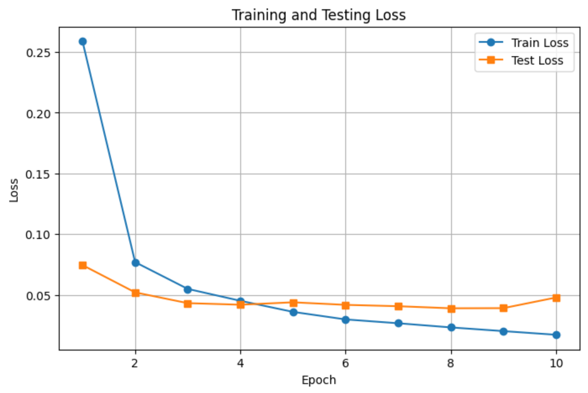
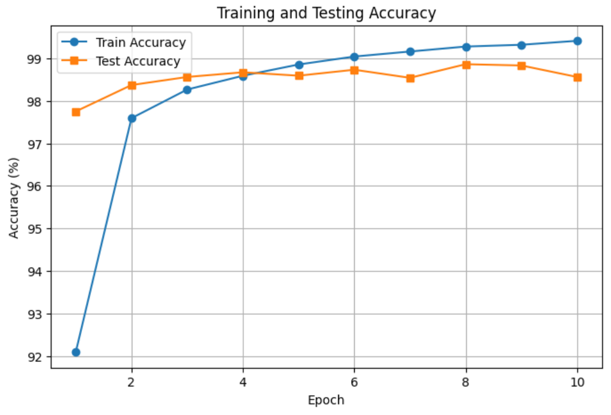
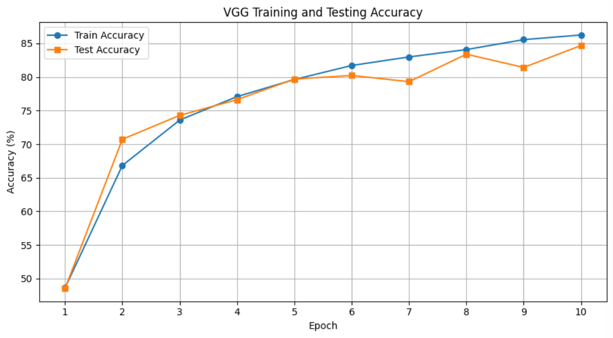
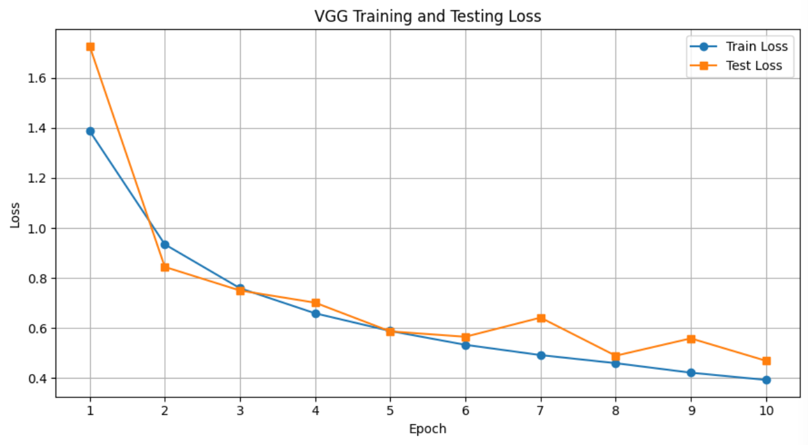
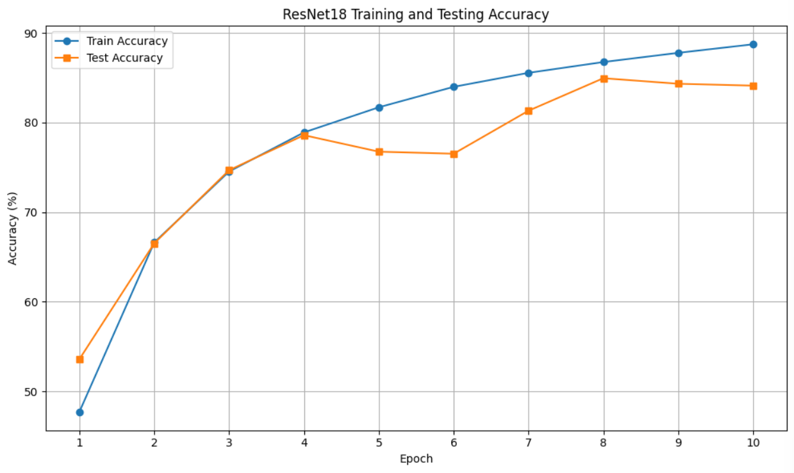
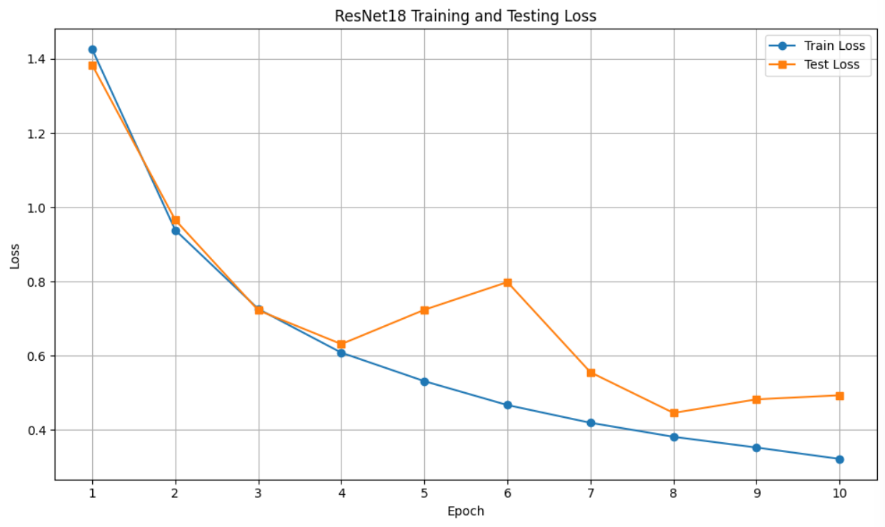
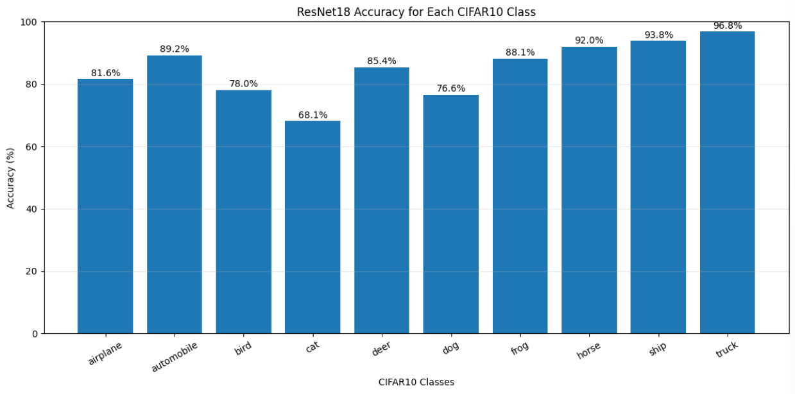

# 深度学习第二周学习报告：卷积神经网络（CNN）

**学习主题：** 卷积神经网络基础与经典 CNN 模型实践

**课程来源：** OUC AI Lab《第2章：卷积神经网络》

**课程链接：** https://oucai.club/classes/dl/week02

**实验环境：** Google Colab、Python、PyTorch、CUDA

**GPU：** NVIDIA Tesla T4

---

# 一、本周学习内容

本周主要学习卷积神经网络（Convolutional Neural Network，CNN）的基本原理，并通过四个实验理解不同网络结构的特点。

本周完成的实验如下：

| 实验 | 实验内容 | 数据集 |
|---|---|---|
| 实验一 | LeNet-5 手写数字识别 | MNIST |
| 实验二 | MLP 与 CNN 对比及像素打乱实验 | MNIST |
| 实验三 | VGG 图像分类 | CIFAR-10 |
| 实验四 | ResNet18 残差网络图像分类 | CIFAR-10 |

本周重点掌握：

1. 卷积层、池化层和全连接层的基本作用。
2. LeNet-5 的网络结构和前向传播过程。
3. CNN 与 MLP 在图像分类任务中的区别。
4. VGG 网络的层次化特征提取方式。
5. ResNet 的残差连接及其对深层网络训练的帮助。
6. 模型训练、测试、准确率统计和结果可视化。

---

# 二、实验一：使用 LeNet-5 对 MNIST 数据集分类

## 2.1 实验目的

使用经典的 LeNet-5 卷积神经网络对 MNIST 手写数字数据集进行分类，理解卷积神经网络的基本组成和训练流程。

通过本实验掌握：

- MNIST 数据集的加载与预处理。
- 卷积层和池化层的作用。
- LeNet-5 的网络结构。
- CrossEntropyLoss 损失函数。
- Adam 优化器。
- 模型训练、测试和最佳模型保存。

## 2.2 数据集加载

MNIST 是经典的手写数字识别数据集，包含 0～9 共 10 个类别。

数据集信息：

| 项目 | 数量或规格 |
|---|---|
| 训练集 | 60000 张 |
| 测试集 | 10000 张 |
| 图像尺寸 | 28 × 28 |
| 图像通道 | 1（灰度图） |
| 分类类别 | 10 |

**数据加载代码：**

```python
import torch
import torch.nn as nn
import torch.optim as optim
from torch.utils.data import DataLoader
from torchvision import datasets, transforms

device = torch.device(
    "cuda" if torch.cuda.is_available() else "cpu"
)

batch_size = 64
learning_rate = 0.001
num_epochs = 10

transform = transforms.Compose([
    transforms.ToTensor(),
    transforms.Normalize((0.1307,), (0.3081,))
])

train_dataset = datasets.MNIST(
    root="./data",
    train=True,
    download=True,
    transform=transform
)

test_dataset = datasets.MNIST(
    root="./data",
    train=False,
    download=True,
    transform=transform
)

train_loader = DataLoader(
    train_dataset,
    batch_size=batch_size,
    shuffle=True
)

test_loader = DataLoader(
    test_dataset,
    batch_size=batch_size,
    shuffle=False
)
```

实际运行结果：

```text
训练集数量：60000
测试集数量：10000

训练集 Batch 数量：938
测试集 Batch 数量：157

图片形状：
torch.Size([64, 1, 28, 28])
```

## 2.3 定义 LeNet-5 网络

LeNet-5 是早期经典卷积神经网络之一。

本次实验采用的网络由两个卷积层、两个池化层和三个全连接层组成。

**网络定义代码：**

```python
class LeNet5(nn.Module):

    def __init__(self):
        super(LeNet5, self).__init__()

        self.conv1 = nn.Conv2d(
            1, 6, kernel_size=5, padding=2
        )

        self.pool1 = nn.MaxPool2d(2, 2)

        self.conv2 = nn.Conv2d(
            6, 16, kernel_size=5
        )

        self.pool2 = nn.MaxPool2d(2, 2)

        self.fc1 = nn.Linear(400, 120)
        self.fc2 = nn.Linear(120, 84)
        self.fc3 = nn.Linear(84, 10)

        self.relu = nn.ReLU()

    def forward(self, x):

        x = self.conv1(x)
        x = self.relu(x)
        x = self.pool1(x)

        x = self.conv2(x)
        x = self.relu(x)
        x = self.pool2(x)

        x = x.view(-1, 400)

        x = self.relu(self.fc1(x))
        x = self.relu(self.fc2(x))

        x = self.fc3(x)

        return x
```

**网络各层尺寸变化：**

| 网络层 | 输出尺寸 |
|---|---|
| 输入图片 | [4, 1, 28, 28] |
| Conv1 | [4, 6, 28, 28] |
| Pool1 | [4, 6, 14, 14] |
| Conv2 | [4, 16, 10, 10] |
| Pool2 | [4, 16, 5, 5] |
| Reshape | [4, 400] |
| FC1 | [4, 120] |
| FC2 | [4, 84] |
| FC3 | [4, 10] |

最终输出 10 个数值，分别对应数字 0～9 的分类得分。

## 2.4 初始化模型、损失函数和优化器

```python
model = LeNet5().to(device)

criterion = nn.CrossEntropyLoss()

optimizer = optim.Adam(
    model.parameters(),
    lr=0.001
)
```

本次配置：

| 项目 | 参数 |
|---|---|
| 设备 | CUDA |
| 损失函数 | CrossEntropyLoss |
| 优化器 | Adam |
| 学习率 | 0.001 |
| Batch Size | 64 |
| Epochs | 10 |

## 2.5 模型训练结果

经过 10 轮训练，模型准确率整体提高，Loss 持续下降。

**每轮训练记录：**

| Epoch | Train Loss | Train Acc | Test Loss | Test Acc |
|---|---:|---:|---:|---:|
| 1 | 0.2589 | 92.09% | 0.0745 | 97.75% |
| 2 | 0.0769 | 97.59% | 0.0520 | 98.37% |
| 3 | 0.0549 | 98.27% | 0.0432 | 98.56% |
| 4 | 0.0451 | 98.59% | 0.0419 | 98.67% |
| 5 | 0.0360 | 98.85% | 0.0438 | 98.59% |
| 6 | 0.0297 | 99.04% | 0.0417 | 98.73% |
| 7 | 0.0266 | 99.16% | 0.0406 | 98.54% |
| 8 | 0.0232 | 99.28% | 0.0389 | 98.86% |
| 9 | 0.0201 | 99.32% | 0.0390 | 98.83% |
| 10 | 0.0171 | 99.41% | 0.0478 | 98.56% |

**最终实验结果：**

| 指标 | 结果 |
|---|---:|
| 最佳测试准确率 | 98.86% |
| 最佳 Epoch | 8 |
| 第10轮训练准确率 | 99.41% |
| 第10轮测试准确率 | 98.56% |
| 模型保存 | 成功 |
| 模型文件 | lenet5_best.pth |

### LeNet-5 Loss 曲线



### LeNet-5 Accuracy 曲线



## 2.6 随机图片预测

训练完成后，使用保存的最佳模型，从 MNIST 测试集中随机抽取 10 张图片进行预测。

实际结果：

```text
LeNet-5 Prediction Results

随机抽取图片数量：10
预测正确数量：10
预测错误数量：0

本次抽样准确率：100%
```

需要注意：这里的 100% 是随机抽取的 10 张图片的抽样结果，并不代表整个测试集准确率。

整个测试集的最佳准确率仍为 98.86%。

## 2.7 实验分析

从训练记录和曲线可以发现：

1. 前几个 Epoch 中，训练 Loss 和测试 Loss 均快速下降，模型能够有效学习手写数字特征。
2. 随着训练进行，训练准确率逐渐提高，说明模型不断优化参数。
3. 第 8 轮达到最高测试准确率 98.86%。
4. 第 9、10 轮训练准确率继续提高，但测试准确率有所下降，说明模型开始出现轻微过拟合。

因此，本次实验选择第 8 轮对应的最佳模型，而不是直接使用最后一轮模型。

## 2.8 实验总结

本实验完成了 LeNet-5 的构建、训练、测试和模型保存。

通过实验，我理解了卷积层提取图像特征、池化层压缩特征图、全连接层完成分类的基本流程。

最终模型在 MNIST 测试集上取得了 98.86% 的准确率，说明 LeNet-5 能够较好地完成手写数字识别任务。

---

# 三、实验二：MLP 与 CNN 的对比实验

## 3.1 实验目的

本实验使用参数量接近的 MLP 和 CNN 对 MNIST 数据集进行分类。

通过比较两个网络在原始图片和像素打乱图片上的表现，理解 CNN 的局部连接、权值共享和池化机制。

## 3.2 数据集加载

```python
input_size = 28 * 28
output_size = 10

train_loader = torch.utils.data.DataLoader(
    datasets.MNIST(
        "./data",
        train=True,
        download=True,
        transform=transform
    ),
    batch_size=64,
    shuffle=True
)

test_loader = torch.utils.data.DataLoader(
    datasets.MNIST(
        "./data",
        train=False,
        download=True,
        transform=transform
    ),
    batch_size=1000,
    shuffle=False
)
```

实际运行结果：

```text
训练集：60000
测试集：10000

训练集 Batch 数量：938
测试集 Batch 数量：10

设备：cuda:0
```

## 3.3 定义 MLP 网络

MLP（Multi-Layer Perceptron，多层感知机）使用全连接层处理输入数据。

由于 MNIST 图片为 28×28，因此需要先将图片展平为 784 维向量。

**网络结构：**

```python
class FC2Layer(nn.Module):

    def __init__(self, input_size, n_hidden, output_size):
        super(FC2Layer, self).__init__()

        self.network = nn.Sequential(
            nn.Linear(input_size, n_hidden),
            nn.ReLU(),

            nn.Linear(n_hidden, n_hidden),
            nn.ReLU(),

            nn.Linear(n_hidden, output_size),
            nn.LogSoftmax(dim=1)
        )

    def forward(self, x):
        x = x.view(-1, 784)
        return self.network(x)
```

网络结构：

```text
Input: 784

Linear: 784 → 8
ReLU

Linear: 8 → 8
ReLU

Linear: 8 → 10
LogSoftmax

Output: 10
```

## 3.4 定义 CNN 网络

CNN（Convolutional Neural Network，卷积神经网络）利用卷积核提取图片中的局部特征。

**网络结构：**

```python
class CNN(nn.Module):

    def __init__(self, input_size, n_feature, output_size):
        super(CNN, self).__init__()

        self.n_feature = n_feature

        self.conv1 = nn.Conv2d(
            1, n_feature, kernel_size=5
        )

        self.conv2 = nn.Conv2d(
            n_feature, n_feature, kernel_size=5
        )

        self.fc1 = nn.Linear(
            n_feature * 4 * 4, 50
        )

        self.fc2 = nn.Linear(50, output_size)

    def forward(self, x):

        x = self.conv1(x)
        x = F.relu(x)
        x = F.max_pool2d(x, 2)

        x = self.conv2(x)
        x = F.relu(x)
        x = F.max_pool2d(x, 2)

        x = x.view(-1, self.n_feature * 4 * 4)

        x = self.fc1(x)
        x = F.relu(x)

        x = self.fc2(x)

        return F.log_softmax(x, dim=1)
```

CNN 的主要处理过程：

```text
Input: [B, 1, 28, 28]

Conv1 + ReLU
MaxPool2d

Conv2 + ReLU
MaxPool2d

Flatten

FC1: 96 → 50
ReLU

FC2: 50 → 10

LogSoftmax
```

## 3.5 模型参数量对比

实验要求两个模型参数量尽可能接近。

实际结果：

| 模型 | 参数量 | 输出形状 |
|---|---:|---|
| MLP | 6442 | [4, 10] |
| CNN | 6422 | [4, 10] |

参数量相差：

```python
mlp_params = 6442
cnn_params = 6422

difference = mlp_params - cnn_params

print(difference)

# 20
```

两个网络的参数量仅相差 20，说明本次实验能够较好地控制模型参数规模这一因素。

## 3.6 训练和测试配置

```python
optimizer = optim.SGD(
    model.parameters(),
    lr=0.01,
    momentum=0.5
)
```

配置如下：

| 项目 | 参数 |
|---|---|
| 优化器 | SGD |
| 学习率 | 0.01 |
| Momentum | 0.5 |
| MLP 参数量 | 6442 |
| CNN 参数量 | 6422 |

## 3.7 原始图片训练结果

实际测试结果：

| 模型 | 测试准确率 | 测试损失 |
|---|---:|---:|
| MLP | 83.76% | 0.5538 |
| CNN | 93.11% | 0.2189 |

CNN 比 MLP 高出：

```text
93.11% - 83.76% = 9.35 个百分点
```

**结果分析：**

在参数量接近的情况下，CNN 明显优于 MLP。

主要原因是：

- MLP 将整张图片展平成一维向量，缺少直接利用局部空间关系的结构。
- CNN 使用卷积核提取局部图像特征。
- 卷积层通过权值共享减少参数量。
- 池化层降低特征图尺寸，并提供一定的平移不变性。

## 3.8 打乱图片像素顺序

为了进一步验证 CNN 对空间结构的依赖，本实验将图片中的像素随机打乱，再使用两个模型进行训练和测试。

**像素打乱代码：**

```python
perm = torch.randperm(784)

def perm_pixel(data, perm):

    data_new = data.view(-1, 28 * 28)

    data_new = data_new[:, perm]

    data_new = data_new.view(-1, 1, 28, 28)

    return data_new
```

`torch.randperm(784)` 会产生 0～783 的随机排列。

原本相邻的像素被重新分配位置，导致原始图片的空间结构遭到破坏。

打乱操作在训练集和测试集中使用相同的像素排列。

## 3.9 打乱像素后的实验结果

实际结果：

| 模型 | 原始图片准确率 | 打乱图片准确率 | 变化 |
|---|---:|---:|---:|
| MLP | 83.76% | 86.32% | +2.56个百分点 |
| CNN | 93.11% | 79.17% | -13.94个百分点 |

对应测试损失：

| 模型 | 原始图片 Loss | 打乱图片 Loss |
|---|---:|---:|
| MLP | 0.5538 | 0.4647 |
| CNN | 0.2189 | 0.6431 |

**结果分析：**

1. CNN 在原始图片上取得了 93.11% 的准确率，明显优于 MLP。
2. 图片像素打乱后，CNN 准确率下降到 79.17%。
3. MLP 的准确率没有出现明显下降，本次实验甚至提高了 2.56 个百分点。

MLP 准确率的上升不代表像素打乱一定有利于 MLP，可能与随机初始化、训练过程等因素有关。

本实验最重要的结论是：CNN 依赖图像局部空间结构，而像素打乱破坏了这种结构，因此 CNN 的性能受到明显影响。

## 3.10 实验总结

通过本实验，我理解了为什么 CNN 特别适合处理图像数据。

即使 MLP 和 CNN 的参数量非常接近，CNN 仍然能够利用卷积和池化提取图像中的局部特征。

像素打乱实验进一步证明，CNN 的优势并不只是来自参数量，而是来自其对图像空间结构的利用。

---

# 四、实验三：使用 VGG 对 CIFAR-10 数据集分类

## 4.1 实验目的

使用 VGG 网络完成 CIFAR-10 彩色图像分类，理解较深卷积神经网络如何逐层提取图像特征。

本实验重点学习：

- VGG 的网络结构。
- Batch Normalization。
- ReLU 激活函数。
- Max Pooling。
- Adaptive Average Pooling。
- 多轮训练及最佳模型保存。
- 分类别准确率统计。

## 4.2 CIFAR-10 数据集

CIFAR-10 是经典的彩色图像分类数据集。

| 项目 | 数据 |
|---|---|
| 训练集 | 50000 张 |
| 测试集 | 10000 张 |
| 图片尺寸 | 32 × 32 |
| 图片通道 | RGB 三通道 |
| 分类类别 | 10 类 |

类别包括：

```python
classes = (
    'airplane',
    'automobile',
    'bird',
    'cat',
    'deer',
    'dog',
    'frog',
    'horse',
    'ship',
    'truck'
)
```

## 4.3 数据预处理

本实验使用数据增强提高模型的泛化能力。

```python
transform_train = transforms.Compose([
    transforms.RandomCrop(32, padding=4),
    transforms.RandomHorizontalFlip(),
    transforms.ToTensor(),
    transforms.Normalize(
        (0.4914, 0.4822, 0.4465),
        (0.2023, 0.1994, 0.2010)
    )
])

transform_test = transforms.Compose([
    transforms.ToTensor(),
    transforms.Normalize(
        (0.4914, 0.4822, 0.4465),
        (0.2023, 0.1994, 0.2010)
    )
])
```

其中：

- RandomCrop：随机裁剪图片。
- RandomHorizontalFlip：随机水平翻转。
- ToTensor：将图片转换为张量。
- Normalize：对图片进行标准化。

训练集使用数据增强，测试集不使用随机增强，以保证评估结果稳定。

## 4.4 定义 VGG 网络

本次采用适配 CIFAR-10 32×32 输入尺寸的简化 VGG 结构。

网络配置：

```python
cfg = [
    64, 'M',
    128, 'M',
    256, 256, 'M',
    512, 512, 'M',
    512, 512, 'M'
]
```

其中：

- 数字代表卷积层输出通道数。
- M 代表最大池化层。
- 卷积层使用 3×3 卷积核。
- 卷积后使用 BatchNorm2d 和 ReLU。

**核心网络代码：**

```python
class VGG(nn.Module):

    def __init__(self):
        super(VGG, self).__init__()

        self.cfg = [
            64, 'M',
            128, 'M',
            256, 256, 'M',
            512, 512, 'M',
            512, 512, 'M'
        ]

        self.features = self._make_layers(self.cfg)

        self.classifier = nn.Linear(512, 10)

    def forward(self, x):

        out = self.features(x)

        out = out.view(out.size(0), -1)

        out = self.classifier(out)

        return out
```

本实验使用的是课程中针对 CIFAR-10 输入尺寸简化后的 VGG 风格结构，并非直接使用未经修改的完整标准 VGG16。

## 4.5 VGG 网络尺寸变化

输入：

```text
torch.Size([4, 3, 32, 32])
```

网络主要尺寸变化：

| 阶段 | 输出尺寸 |
|---|---|
| Input | [4, 3, 32, 32] |
| Conv1 | [4, 64, 32, 32] |
| MaxPool1 | [4, 64, 16, 16] |
| Conv2 | [4, 128, 16, 16] |
| MaxPool2 | [4, 128, 8, 8] |
| Conv3、Conv4 | [4, 256, 8, 8] |
| MaxPool3 | [4, 256, 4, 4] |
| Conv5、Conv6 | [4, 512, 4, 4] |
| MaxPool4 | [4, 512, 2, 2] |
| Conv7、Conv8 | [4, 512, 2, 2] |
| MaxPool5 | [4, 512, 1, 1] |
| AvgPool | [4, 512, 1, 1] |
| Flatten | [4, 512] |
| FC | [4, 10] |

可以看出，随着卷积和池化操作不断进行，特征图的通道数逐渐增加，而空间尺寸逐渐减小。

## 4.6 初始化模型

```python
model = VGG().to(device)

criterion = nn.CrossEntropyLoss()

optimizer = optim.Adam(
    model.parameters(),
    lr=0.001
)
```

实际运行环境：

```text
GPU：Tesla T4
设备：cuda:0

训练集：50000
测试集：10000

训练集 Batch 数量：391
测试集 Batch 数量：79

Batch Size：128
Learning Rate：0.001
Epochs：10
```

模型参数量：

```text
VGG Parameters: 9231114
```

模型文件大小：

```text
35.25 MB
```

## 4.7 VGG 训练结果

**10 轮训练记录：**

| Epoch | Train Loss | Train Acc | Test Loss | Test Acc |
|---|---:|---:|---:|---:|
| 1 | 1.3883 | 48.62% | 1.7280 | 48.52% |
| 2 | 0.9345 | 66.83% | 0.8443 | 70.73% |
| 3 | 0.7590 | 73.59% | 0.7498 | 74.29% |
| 4 | 0.6585 | 77.08% | 0.7011 | 76.62% |
| 5 | 0.5877 | 79.62% | 0.5861 | 79.69% |
| 6 | 0.5324 | 81.71% | 0.5646 | 80.23% |
| 7 | 0.4913 | 82.98% | 0.6412 | 79.30% |
| 8 | 0.4589 | 84.08% | 0.4887 | 83.39% |
| 9 | 0.4209 | 85.55% | 0.5581 | 81.42% |
| 10 | 0.3919 | 86.25% | 0.4686 | 84.68% |

最终加载最佳模型后测试：

```text
测试图片数量：10000
预测正确数量：8468

测试损失：0.4668
测试准确率：84.68%

最佳 Epoch：10
```

模型保存位置：

```text
./checkpoints/vgg_cifar10_best.pth
```

### VGG Accuracy 曲线



### VGG Loss 曲线



## 4.8 各类别准确率统计

最终测试结果：

| 类别 | 正确数量 | 准确率 |
|---|---:|---:|
| airplane | 822 | 82.20% |
| automobile | 945 | 94.50% |
| bird | 747 | 74.70% |
| cat | 715 | 71.50% |
| deer | 919 | 91.90% |
| dog | 700 | 70.00% |
| frog | 909 | 90.90% |
| horse | 886 | 88.60% |
| ship | 911 | 91.10% |
| truck | 914 | 91.40% |

### VGG 各类别准确率统计

当前 `week02/images` 目录中没有单独上传 VGG 各类别准确率柱状图，因此本节保留上方实际测试数据表格和文字分析，不引用不存在的图片。

**结果分析：**

- 识别效果最高的类别是 automobile，准确率达到 94.50%。
- 识别效果最低的类别是 dog，准确率为 70.00%。
- deer、frog、ship 和 truck 等类别识别效果较好。
- cat、dog 和 bird 等类别识别相对困难。

不同类别之间的识别准确率存在明显差异，说明不同图像类别的特征复杂程度会影响模型的分类效果。

## 4.9 实验总结

本次 VGG 实验成功完成了 CIFAR-10 数据集分类。

模型经过 10 轮训练，最佳测试准确率达到 84.68%。

通过实验，我理解了较深的卷积神经网络如何通过多个卷积模块逐层提取特征，并通过池化层降低特征图空间尺寸。

同时，通过各类别准确率统计，我进一步认识到整体准确率不能完全反映模型在每个类别上的表现。

---

# 五、实验四：使用 ResNet18 对 CIFAR-10 分类

## 5.1 实验目的

本实验使用 ResNet18 完成 CIFAR-10 分类，并与前面的 VGG 网络进行比较。

重点理解：

- 残差连接（Residual Connection）。
- BasicBlock 基本残差块。
- Shortcut 捷径连接。
- 1×1 卷积调整通道和尺寸。
- 深层神经网络的训练特点。

## 5.2 ResNet18 基本结构

ResNet18 由多个残差块组成。

每个 BasicBlock 包含两个 3×3 卷积层，以及 BatchNorm、ReLU 和 Shortcut 连接。

**BasicBlock 核心代码：**

```python
class BasicBlock(nn.Module):

    expansion = 1

    def __init__(self, in_channels, out_channels, stride=1):
        super(BasicBlock, self).__init__()

        self.conv1 = nn.Conv2d(
            in_channels,
            out_channels,
            kernel_size=3,
            stride=stride,
            padding=1,
            bias=False
        )

        self.bn1 = nn.BatchNorm2d(out_channels)

        self.conv2 = nn.Conv2d(
            out_channels,
            out_channels,
            kernel_size=3,
            stride=1,
            padding=1,
            bias=False
        )

        self.bn2 = nn.BatchNorm2d(out_channels)

        self.shortcut = nn.Sequential()

        if stride != 1 or in_channels != out_channels:

            self.shortcut = nn.Sequential(
                nn.Conv2d(
                    in_channels,
                    out_channels,
                    kernel_size=1,
                    stride=stride,
                    bias=False
                ),
                nn.BatchNorm2d(out_channels)
            )

    def forward(self, x):

        out = F.relu(self.bn1(self.conv1(x)))

        out = self.bn2(self.conv2(out))

        out += self.shortcut(x)

        out = F.relu(out)

        return out
```

## 5.3 残差连接原理

普通卷积网络需要逐层传递特征。

当网络不断加深时，可能出现梯度消失和网络退化等问题。

ResNet 引入 Shortcut，使输入可以直接跨过部分卷积层，与卷积分支的结果相加。

其核心表达式为：

```text
Output = F(x) + x
```

其中：

- x：输入特征。
- F(x)：卷积层学习到的残差。
- Output：残差分支与捷径分支相加后的结果。

当输入和输出的尺寸不一致时，需要通过 1×1 卷积调整维度，使两条分支能够相加。

## 5.4 ResNet18 网络结构

ResNet18 使用四组残差层，每组包含两个 BasicBlock。

```python
def ResNet18(num_classes=10):

    return ResNet(
        BasicBlock,
        [2, 2, 2, 2],
        num_classes
    )
```

网络主要结构：

```text
Input: 3 × 32 × 32

Initial Conv + BN + ReLU

Layer1:
    2 × BasicBlock

Layer2:
    2 × BasicBlock

Layer3:
    2 × BasicBlock

Layer4:
    2 × BasicBlock

AdaptiveAvgPool2d(1, 1)

Flatten

Fully Connected:
    512 → 10

Output: 10 classes
```

## 5.5 网络尺寸变化

以 Batch Size 为 4 的输入为例：

| 网络阶段 | 输出尺寸 |
|---|---|
| Input | [4, 3, 32, 32] |
| Initial Conv | [4, 64, 32, 32] |
| Layer1 | [4, 64, 32, 32] |
| Layer2 | [4, 128, 16, 16] |
| Layer3 | [4, 256, 8, 8] |
| Layer4 | [4, 512, 4, 4] |
| AdaptiveAvgPool | [4, 512, 1, 1] |
| Flatten | [4, 512] |
| FC | [4, 10] |

最终网络输出：

```text
torch.Size([4, 10])
```

## 5.6 模型初始化

```python
model = ResNet18(num_classes=10).to(device)

criterion = nn.CrossEntropyLoss()

optimizer = optim.Adam(
    model.parameters(),
    lr=0.001
)
```

实验环境：

```text
GPU：Tesla T4
模型设备：cuda:0

训练集：50000
测试集：10000

训练集 Batch 数量：391
测试集 Batch 数量：79

Batch Size：128
Learning Rate：0.001
Epochs：10
```

模型参数量：

```text
ResNet18 Parameters: 11173962
```

模型文件：

```text
./checkpoints/resnet18_cifar10_best.pth
```

文件大小：

```text
42.70 MB
```

## 5.7 ResNet18 训练结果

**10 轮训练记录：**

| Epoch | Train Loss | Train Acc | Test Loss | Test Acc |
|---|---:|---:|---:|---:|
| 1 | 1.4257 | 47.71% | 1.3836 | 53.59% |
| 2 | 0.9387 | 66.62% | 0.9660 | 66.53% |
| 3 | 0.7262 | 74.54% | 0.7225 | 74.69% |
| 4 | 0.6084 | 78.91% | 0.6315 | 78.60% |
| 5 | 0.5316 | 81.71% | 0.7239 | 76.76% |
| 6 | 0.4672 | 84.00% | 0.7986 | 76.53% |
| 7 | 0.4194 | 85.56% | 0.5556 | 81.33% |
| 8 | 0.3816 | 86.76% | 0.4460 | 84.96% |
| 9 | 0.3528 | 87.79% | 0.4826 | 84.34% |
| 10 | 0.3220 | 88.74% | 0.4935 | 84.13% |

最终测试结果：

```text
测试图片数量：10000
预测正确数量：8496

测试损失：0.4460
测试准确率：84.96%

最佳 Epoch：8
```

### ResNet18 Accuracy 曲线



### ResNet18 Loss 曲线



## 5.8 各类别准确率统计

| 类别 | 正确数量 | 准确率 |
|---|---:|---:|
| airplane | 816 | 81.60% |
| automobile | 892 | 89.20% |
| bird | 780 | 78.00% |
| cat | 681 | 68.10% |
| deer | 854 | 85.40% |
| dog | 766 | 76.60% |
| frog | 881 | 88.10% |
| horse | 920 | 92.00% |
| ship | 938 | 93.80% |
| truck | 968 | 96.80% |

### ResNet18 各类别准确率柱状图



**结果分析：**

- truck 的识别准确率最高，达到 96.80%。
- ship 的准确率为 93.80%。
- horse 的准确率为 92.00%。
- cat 的识别准确率最低，为 68.10%。

可以看出，ResNet18 对部分交通工具类别识别效果很好，但对于 cat 等类别仍存在一定的分类困难。

## 5.9 训练曲线分析

从 Loss 曲线可以发现：

1. 训练 Loss 从 1.4257 逐渐下降到 0.3220。
2. 测试 Loss 在前几轮明显下降。
3. 第 8 轮测试 Loss 达到最低值 0.4460。
4. 第 9、10 轮测试 Loss 有所回升。

从 Accuracy 曲线可以发现：

1. 训练准确率持续上升。
2. 测试准确率总体呈上升趋势。
3. 第 8 轮达到最高测试准确率 84.96%。
4. 第 9、10 轮训练准确率继续上升，但测试准确率有所下降。

说明模型在第 8 轮达到最佳泛化效果，之后出现了一定程度的过拟合。

因此，本实验保留第 8 轮的最佳模型，而不是直接使用第 10 轮模型。

## 5.10 实验总结

本次实验成功完成了 ResNet18 的构建和 CIFAR-10 分类任务。

最终测试准确率达到 84.96%。

通过实验，我进一步理解了残差连接的工作原理，以及 Shortcut 如何在不同网络阶段帮助信息传递。

与普通卷积网络相比，ResNet 能够通过残差结构构建更深的网络，为复杂图像特征提取提供更好的结构支持。

---

# 六、VGG 与 ResNet18 综合对比

本周实验三和实验四使用相同的 CIFAR-10 数据集，分别训练 VGG 和 ResNet18。

两者都完成了 10 轮训练，并进行了最佳模型保存和分类别准确率统计。

## 6.1 整体性能对比

| 对比项目 | VGG | ResNet18 |
|---|---:|---:|
| 训练集 | 50000 | 50000 |
| 测试集 | 10000 | 10000 |
| Epochs | 10 | 10 |
| Batch Size | 128 | 128 |
| 优化器 | Adam | Adam |
| 学习率 | 0.001 | 0.001 |
| 参数量 | 9231114 | 11173962 |
| 模型大小 | 35.25 MB | 42.70 MB |
| 最佳 Epoch | 10 | 8 |
| 最佳测试准确率 | 84.68% | 84.96% |
| 最佳测试 Loss | 0.4668 | 0.4460 |

准确率差异：

```text
84.96% - 84.68% = 0.28 个百分点
```

ResNet18 的测试准确率比 VGG 高出 0.28 个百分点。

但 ResNet18 的参数量和模型文件大小也更大。

## 6.2 参数量对比

```text
VGG:
9,231,114 Parameters

ResNet18:
11,173,962 Parameters

参数量差值：
1,942,848
```

ResNet18 的参数量约比 VGG 多 21%。

模型文件大小也增加了约 7.45 MB。

## 6.3 各类别识别效果对比

| 类别 | VGG | ResNet18 | 表现较好 |
|---|---:|---:|---|
| airplane | 82.20% | 81.60% | VGG |
| automobile | 94.50% | 89.20% | VGG |
| bird | 74.70% | 78.00% | ResNet18 |
| cat | 71.50% | 68.10% | VGG |
| deer | 91.90% | 85.40% | VGG |
| dog | 70.00% | 76.60% | ResNet18 |
| frog | 90.90% | 88.10% | VGG |
| horse | 88.60% | 92.00% | ResNet18 |
| ship | 91.10% | 93.80% | ResNet18 |
| truck | 91.40% | 96.80% | ResNet18 |

从类别表现来看：

- VGG 在 airplane、automobile、cat、deer、frog 五个类别上表现更好。
- ResNet18 在 bird、dog、horse、ship、truck 五个类别上表现更好。

## 6.4 综合分析

ResNet18 的整体准确率略高于 VGG，但优势只有 0.28 个百分点。

这说明网络结构更复杂、参数量更多，并不意味着每个类别的识别效果都会更好。

VGG 结构相对直接，主要通过连续卷积层和池化层提取特征。

ResNet18 则通过残差连接改善深层网络的信息传递和优化过程。

本次实验中，ResNet18 在 truck、ship 和 horse 等类别上的识别效果较好，而 VGG 在 automobile、deer 和 cat 等类别上表现更好。

因此，模型选择需要综合考虑：

- 整体分类准确率。
- 各类别识别效果。
- 模型参数量。
- 模型文件大小。
- 训练时间和推理成本。

---

# 七、本周博客思考题

## 1. DataLoader 里面 shuffle 取不同值有什么区别？

`shuffle` 用来控制 DataLoader 是否打乱数据集中的样本顺序。

**shuffle=True：**

```python
train_loader = DataLoader(
    train_dataset,
    batch_size=64,
    shuffle=True
)
```

每个 Epoch 开始时随机打乱样本顺序。

优点：

- 避免模型长期按照固定顺序学习数据。
- 减少样本排列顺序带来的影响。
- 有助于模型学习更加稳定的特征。

**shuffle=False：**

```python
test_loader = DataLoader(
    test_dataset,
    batch_size=64,
    shuffle=False
)
```

按照数据集原来的顺序读取样本。

优点：

- 便于复现实验结果。
- 便于对应预测结果与原始样本。
- 适合验证和测试阶段。

需要注意：只要完整遍历同一测试集，打乱样本顺序本身通常不会改变整体准确率，但会影响样本输出顺序。

## 2. Transform 里面取不同值有什么区别？

Transform 用来对输入图片进行预处理和数据增强。

不同的 Transform 会改变输入模型的数据形式和分布。

常见操作：

**ToTensor：**

```python
transforms.ToTensor()
```

将图片转换为 PyTorch Tensor，并将像素值缩放到 0～1。

**Normalize：**

```python
transforms.Normalize(
    (0.4914, 0.4822, 0.4465),
    (0.2023, 0.1994, 0.2010)
)
```

对 RGB 三个通道分别进行标准化。

计算方式：

```text
output = (input - mean) / std
```

**RandomCrop：**

```python
transforms.RandomCrop(32, padding=4)
```

随机裁剪图片，增加图片位置变化。

**RandomHorizontalFlip：**

```python
transforms.RandomHorizontalFlip()
```

随机进行水平翻转，增加训练数据的多样性。

本次实验中，训练集使用随机裁剪和水平翻转，而测试集使用确定性的预处理。

通过这些操作，可以帮助模型减少对固定训练图片的依赖，提高泛化能力。

## 3. Epoch 和 Batch 有什么区别？

Epoch 和 Batch 都是模型训练中的基本概念。

**Batch：**

一次输入模型的一批数据。

**Epoch：**

模型完整遍历一次训练集。

以 MNIST 为例：

```text
训练集数量：60000
Batch Size：64

每个 Epoch 的 Batch 数量：

60000 / 64 ≈ 938
```

也就是说：

```text
1 Batch = 64 张图片（最后一个 Batch 可能不足64张）

1 Epoch = 完整训练60000张图片
```

以 CIFAR-10 为例：

```text
训练集数量：50000
Batch Size：128

每个 Epoch 的 Batch 数量：

50000 / 128 ≈ 391
```

因此，Batch 决定每次更新参数使用多少样本，而 Epoch 决定完整学习训练集多少遍。

## 4. 1×1 卷积和全连接层有什么区别？主要起什么作用？

1×1 卷积和全连接层都可以进行特征维度变换，但它们的连接方式不同。

**1×1 卷积：**

```python
nn.Conv2d(
    in_channels=64,
    out_channels=128,
    kernel_size=1
)
```

作用：

- 调整特征图通道数。
- 融合不同通道的信息。
- 降低或增加特征维度。
- 减少部分网络结构中的计算量。

对于输入特征图，每个空间位置都会使用相同的卷积权重进行通道变换。

参数量计算：

```text
Parameters = Cin × Cout + Cout
```

其中：

- Cin：输入通道数。
- Cout：输出通道数。

**全连接层：**

```python
nn.Linear(
    in_features=512,
    out_features=10
)
```

全连接层将输入的所有特征与输出神经元连接起来。

参数量计算：

```text
Parameters = 输入维度 × 输出维度 + 偏置
```

**两者主要区别：**

| 对比项目 | 1×1 卷积 | 全连接层 |
|---|---|---|
| 连接方式 | 局部空间位置上的通道连接 | 所有输入特征与输出神经元连接 |
| 权重共享 | 不同空间位置共享权重 | 不同输入位置拥有独立权重 |
| 空间结构 | 保留空间排列 | 通常需要先展平 |
| 主要用途 | 通道调整、特征融合 | 分类和特征映射 |

简单来说，1×1 卷积主要负责特征图通道之间的信息融合，而全连接层主要负责将提取到的特征映射到最终分类结果。

---

# 八、本周实验中遇到的问题与解决

本周实验主要在 Google Colab 环境下完成，期间遇到了一些环境和代码问题。

## 8.1 GPU 后端无法分配

遇到的问题：

```text
无法分配后端
无法使用带 GPU 的后端
```

原因：

Colab 当时无法提供可用的 GPU 运行资源。

解决方法：

- 检查 Colab 运行时设置。
- 重新连接运行时。
- 等待 GPU 资源恢复。
- 重新确认 CUDA 是否可用。

验证代码：

```python
import torch

print(torch.cuda.is_available())

if torch.cuda.is_available():
    print(torch.cuda.get_device_name(0))
```

最终成功使用 Tesla T4 GPU。

## 8.2 CIFAR-10 下载失败

遇到的问题：

```text
RuntimeError:
File not found or corrupted.
```

问题出现在 CIFAR-10 数据集下载过程中。

后续重新加载数据集，最终成功完成数据加载和模型训练。

## 8.3 ResNet18 网络定义错误

遇到的问题：

```text
NameError:
name 'Exp4BasicBlock' is not defined
```

原因：

在构建 ResNet18 时，调用了尚未定义的 BasicBlock 类。

解决思路：

先定义 BasicBlock，再定义 ResNet 网络结构，最后创建 ResNet18 实例。

最终模型成功创建，并通过随机输入测试：

```text
输入形状：
torch.Size([4, 3, 32, 32])

输出形状：
torch.Size([4, 10])
```

---

# 九、本周学习总结

通过本周四个实验，我从简单的手写数字识别逐渐过渡到更加复杂的彩色图像分类任务。

在实验一中，我完成了 LeNet-5 的构建和训练，理解了卷积、池化和全连接层之间的关系，最终取得了 98.86% 的测试准确率。

在实验二中，我比较了参数量接近的 MLP 和 CNN。实验结果表明，CNN 能够更有效地利用图像的局部空间信息。通过打乱图片像素顺序，我进一步理解了卷积神经网络为什么依赖图像空间结构。

在实验三中，我学习了 VGG 网络的层次化特征提取方式，完成了 CIFAR-10 分类任务，最佳测试准确率达到 84.68%。

在实验四中，我进一步学习了 ResNet18 的残差连接结构，理解了 Shortcut 和 1×1 卷积在网络中的作用，最终取得了 84.96% 的测试准确率。

通过 VGG 和 ResNet18 的对比，我认识到模型性能不能只看网络深度和参数量，还需要结合测试准确率、分类别表现、模型大小和计算成本进行综合评价。

## 本周实验最终结果汇总

| 实验 | 模型 | 数据集 | 最佳测试准确率 |
|---|---|---|---:|
| 实验一 | LeNet-5 | MNIST | 98.86% |
| 实验二 | MLP | MNIST | 83.76% |
| 实验二 | CNN | MNIST | 93.11% |
| 实验二 | 打乱像素 MLP | MNIST | 86.32% |
| 实验二 | 打乱像素 CNN | MNIST | 79.17% |
| 实验三 | VGG | CIFAR-10 | 84.68% |
| 实验四 | ResNet18 | CIFAR-10 | 84.96% |

## 后续学习计划

1. 继续深入理解卷积神经网络的底层计算原理。
2. 学习 AlexNet、GoogleNet 等经典网络。
3. 深入理解 ResNet 的残差连接和梯度传播。
4. 学习迁移学习和预训练模型。
5. 尝试通过数据增强、学习率调整和模型优化提高分类准确率。
6. 进一步研究不同网络结构在相同数据集上的性能差异。

---

# 十、参考资料

1. OUC AI Lab：《第2章：卷积神经网络》

   https://oucai.club/classes/dl/week02

2. PyTorch 官方文档

   https://pytorch.org/docs/stable/index.html

3. VGG 原始论文：

   Very Deep Convolutional Networks for Large-Scale Image Recognition

4. ResNet 原始论文：

   Deep Residual Learning for Image Recognition

---

**报告说明：**

本报告根据第二周课程内容和实际实验运行记录整理。实验数据以本次实际运行结果为准。

图片仅保留训练 Loss 曲线、Accuracy 曲线和分类别准确率柱状图；网络结构、代码运行过程、模型输出和其他实验结果均采用 Markdown 代码块、表格及文字说明。
